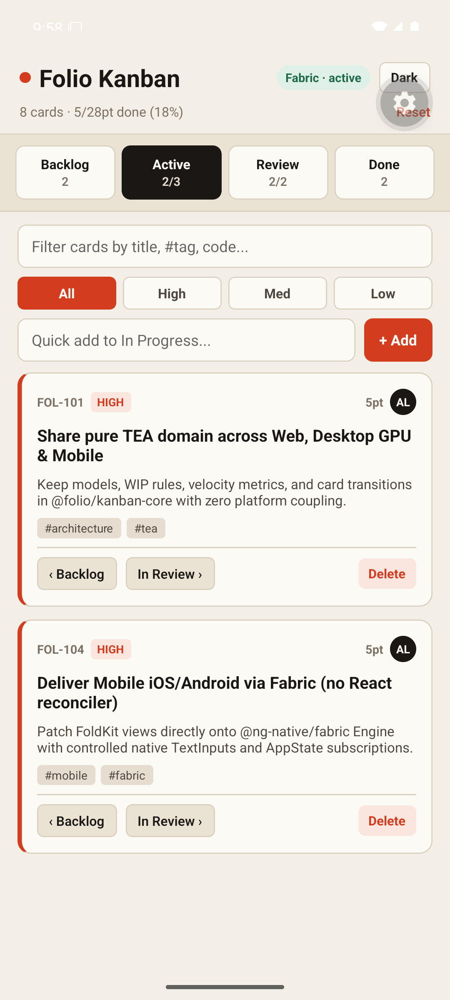

# Folio Kanban — One Unified `@effect/ui` App Across Web, Desktop GPU & Mobile

**One unified `@effect/ui` app (`@folio/folio-app`). One universal vocabulary (`@folio/effect-ui-universal`). One framework-agnostic interaction layer ([`@ui-sdk/core`](https://ui-sdk.dev)). Three completely different native & web rendering engines. Zero React reconcilers. Zero WebViews.**

Folio Kanban demonstrates how **a single `@effect/ui` + Effect v4 application** (`FolioApp`), backed by a shared functional core ([`@folio/kanban-core`](./packages/kanban-core)), framework-agnostic interaction behaviors ([`@folio/effect-ui-sdk`](./packages/effect-ui-sdk)), and a universal cross-platform `View.Vocabulary` ([`@folio/effect-ui-universal`](./packages/effect-ui-universal)), can render natively across three distinct targets via `@effect/ui`'s `Renderer.Host<Node>` seam:

1. **Web DOM** (`apps/web` — 24-line launcher) — `FolioApp` mounted onto `WebHost` (pure DOM `Renderer.Host`, zero React) + `localStorage` `BoardStorage` + `visibilitychange` `AppLifecycle` + Vite
2. **Desktop Native GPU** (`apps/desktop-gpui` — 25-line launcher) — `FolioApp` mounted onto **`@folio/effect-ui-gpui`** `GpuiHost` driving **Zed's GPUI** directly in-process via `@gpuix/native` (Wayland / Metal — no Electron, no WebView, no DOM shim) + JSON file `BoardStorage`
3. **Mobile Native iOS & Android** (`apps/mobile-fabric` — 15-line launcher) — `FolioApp` mounted onto **`@folio/effect-ui-fabric`** `FabricHost` driving **React Native's C++ Fabric UIManager** directly via `@ng-native/fabric` + Expo SDK 57 (Hermes — no React reconciler) + native `AppState` `AppLifecycle`

---

## Screenshots Across Every Platform

### 1. Web DOM (`FolioApp` → `WebHost` DOM + Vite — No React)


### 2. Desktop Native GPU (`FolioApp` → `GpuiHost` → Zed GPUI on Wayland — No Electron / No WebView)


### 3. Mobile Native Android (`FolioApp` → `FabricHost` → `@ng-native/fabric` — No React Reconciler)
<p align="center">
  
</p>

---

## Unified Architecture

```text
                       ┌───────────────────────────────────────────┐
                       │           @folio/kanban-core              │
                       │  Zero-dependency pure TypeScript:         │
                       │  lanes, WIP limits, velocity, filter,     │
                       │  immutable undo/redo, Schemas & palettes  │
                       └────────────────────┬──────────────────────┘
                                            │
                       ┌────────────────────▼──────────────────────┐
                       │         @folio/effect-ui-sdk              │
                       │   Vercel UI SDK (@ui-sdk/core) bridge:    │
                       │  deriveBoardView · deriveCardEditorControls
                       │  segmentedControl · tabs · progress       │
                       │  fuzzy text-match · kanbanBoard primitive │
                       └────────────────────┬──────────────────────┘
                                            │
                       ┌────────────────────▼──────────────────────┐
                       │       @folio/effect-ui-universal          │
                       │  Single View.Vocabulary ("folio-ui"):     │
                       │  box · scroll · button · text · input ·   │
                       │  textarea (textParents: ["text"]) +       │
                       │  normalized UiStyle & WebHost (pure DOM)  │
                       └────────────────────┬──────────────────────┘
                                            │
                       ┌────────────────────▼──────────────────────┐
                       │             @folio/folio-app              │
                       │  ONE unified @effect/ui app (FolioApp):   │
                       │  1 Model · 1 Message · 1 Update · 1 View  │
                       │  • layout: "columns" (Web / Desktop GPU)  │
                       │  • layout: "tabs" (Mobile Fabric)         │
                       │  Typed Effect services:                   │
                       │  BoardStorage · SaveBoard · AppLifecycle  │
                       └─┬──────────────────┬────────────────────┬─┘
                         │                  │                    │
           ┌─────────────▼────────┐ ┌───────▼────────────┐ ┌─────▼────────────────┐
           │      apps/web        │ │  apps/desktop-gpui │ │  apps/mobile-fabric  │
           │  Thin Web launcher   │ │  Thin GPU launcher │ │ Thin Mobile launcher │
           │  WebHost (DOM) +     │ │  GpuiHost -> gpuix │ │ FabricHost -> Engine │
           │  localStorage Layer  │ │  FileStorage Layer │ │ AppState Layer +     │
           │  + Vite              │ │  -> Zed GPUI       │ │ Expo SDK 57 -> Fabric│
           └──────────────────────┘ └────────────────────┘ └──────────────────────┘
```

### Key Architectural Layers

- **`@folio/kanban-core`** (`packages/kanban-core`): Pure TypeScript domain model (`KanbanCard`, 4 lanes with WIP limits, velocity math, pure immutable TEA undo/redo history & session transitions), shared Effect v4 Schemas (`@folio/kanban-core/schema`), and **Paper & Graphite** editorial design palettes (`@folio/kanban-core/theme`).
- **`@folio/effect-ui-sdk`** (`packages/effect-ui-sdk`): Bridges **[`@ui-sdk/core`](https://ui-sdk.dev)** into `@effect/ui` — `deriveBoardView`, `deriveCardEditorControls`, `segmentedControl`, `tabs`, `progress`, locale-aware fuzzy search & match highlighting, `transferMessage` announcements, and the custom `kanbanBoard` primitive tested in strict mode.
- **`@folio/effect-ui-universal`** (`packages/effect-ui-universal`): Defines the unified `"folio-ui"` `View.Vocabulary` (`h.box`, `h.scroll`, `h.button`, `h.text`, `h.input`, `h.textarea`) with `textParents: ["text"]` enforced by `@effect/ui`, normalized flexbox styling (`UiStyle`), normalized events (`press`, `changeText`, `submit`, `keyDown`), and `WebHost` (`@folio/effect-ui-universal/web`) — a pure DOM `Renderer.Host<Node>` with zero React.
- **`@folio/effect-ui-gpui`** (`packages/effect-ui-gpui`): Implements `Renderer.Host<GpuiNode>` on `@gpuix/native` (Zed GPUI), supporting both native `Gpui` and universal `"folio-ui"` vocabularies with single-batch `applyBatch` FFI flushes and native window titlebar syncing via `Head.title`.
- **`@folio/effect-ui-fabric`** (`packages/effect-ui-fabric`): Implements `Renderer.Host<EngineNode>` on `@ng-native/fabric` (React Native C++ Fabric), supporting both native `Fabric` and universal `"folio-ui"` vocabularies with Pressability touch responders, controlled `TextInput` reconciliation, single-commit `engine.commit()`, and native `AppState` subscriptions.
- **`@folio/folio-app`** (`packages/folio-app`): The **single unified `@effect/ui` application** (`FolioApp`) shared across all three platforms — providing live **Paper ↔ Graphite** theme switching, **Undo/Redo**, fuzzy search + match highlighting, `@ui-sdk/core` segmented filters/pickers/tabs/progress, **Detailed / Compact** card density, inline quick-add, modal/full-screen card editor, live **MVU Trace** inspector panel, and typed Effect `BoardStorage` & `AppLifecycle` services.

---

## Project Layout

```text
.
├── .npmrc                          # Workspace package config
├── package.json                    # npm workspaces (packages/*, apps/*) & root scripts
├── tsconfig.base.json              # Shared strict + exactOptionalPropertyTypes config
├── packages/
│   ├── kanban-core/                # @folio/kanban-core (pure domain, ./schema, ./theme)
│   ├── effect-ui-sdk/              # @folio/effect-ui-sdk (@ui-sdk/core behaviors & kanbanBoard)
│   ├── effect-ui-universal/        # @folio/effect-ui-universal (Ui vocabulary + WebHost DOM host)
│   ├── effect-ui-gpui/             # @folio/effect-ui-gpui (@effect/ui Renderer.Host for Zed GPUI)
│   ├── effect-ui-fabric/           # @folio/effect-ui-fabric (@effect/ui Renderer.Host for RN Fabric)
│   └── folio-app/                  # @folio/folio-app (ONE unified FolioApp component & views)
└── apps/
    ├── web/                        # @folio/web (thin WebHost + localStorage + Vite launcher)
    ├── desktop-gpui/               # @folio/desktop-gpui (thin GpuiHost + JSON file launcher)
    └── mobile-fabric/              # @folio/mobile-fabric (thin FabricHost + Expo SDK 57 launcher)
```

---

## Quick Start

### 1. Install all workspace dependencies once at the root

```bash
npm install
```

### 2. Run all tests, type-checks, and builds across every workspace

```bash
npm test          # Runs core + sdk + universal + folio-app + web + desktop-gpui + mobile-fabric
npm run typecheck # Strict + exactOptionalPropertyTypes check across all 7 workspaces
npm run build:web # Production Vite build of the Web launcher
```

### 3. Launch each delivery platform

#### Web (`FolioApp` on `WebHost` DOM)
```bash
npm run dev:web
```

#### Desktop Native GPU (`FolioApp` on `GpuiHost` → Zed GPUI)
Requires Linux (Wayland + `libxkbcommon`, `libwayland-client`, Vulkan/EGL) or macOS (Apple Silicon / Metal):
```bash
npm run start:desktop
```

#### Mobile Native iOS / Android (`FolioApp` on `FabricHost` → React Native Fabric)
Requires an Expo SDK 57 dev client build (Expo Go is not supported because `@effect/ui` renders directly through Fabric without React):
```bash
cd apps/mobile-fabric
npm run prebuild
npm run android   # Requires Android SDK (API 36, NDK 27) + JDK 21 + connected device or emulator
# or on macOS with Xcode:
npm run ios
```

> **Note for Linux pure-Wayland desktops (e.g. Hyprland with `xwayland:enabled = false`)**: Android Emulator's bundled Qt ships `xcb` rather than Wayland. You can run it cleanly inside a nested `labwc` Wayland window without enabling XWayland globally:
> ```bash
> WLR_WL_OUTPUTS=1 labwc -s "env QT_QPA_PLATFORM=xcb $ANDROID_HOME/emulator/emulator -avd <your_avd> -gpu auto"
> ```

---

## Credits & Upstream Projects

- **[@effect/ui](https://ui.effect.website)** & **[Effect](https://effect.website)** — Effect-TS team
- **[UI SDK (`@ui-sdk/core`)](https://ui-sdk.dev)** — Vercel Labs framework-agnostic interaction behaviors & component building blocks
- **[gpuix](https://github.com/remorses/gpuix)** & **[GPUI](https://github.com/zed-industries/zed/tree/main/crates/gpui)** — Zed GPU UI framework & Node/Bun bindings
- **[@ng-native/fabric](https://github.com/ng-native/ng-native)** — Direct React Native Fabric engine without React
- Inspired by the pioneering native TEA host explorations in **[Manzanita-Research/foldkit-native](https://github.com/Manzanita-Research/foldkit-native)** and **[giovannilondero/foldkit-native](https://github.com/giovannilondero/foldkit-native)**
