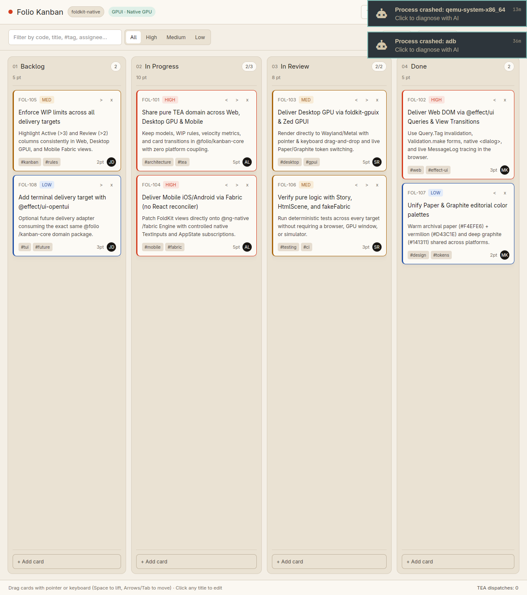

# Folio Kanban — Multi-Platform Pure TEA Without React

**One Kanban board. Three completely different native & web rendering engines. Zero React reconcilers.**

Folio Kanban is a proof-of-concept monorepo demonstrating how a single, zero-dependency functional domain ([`@folio/kanban-core`](./packages/kanban-core)) built around **The Elm Architecture (TEA)** and **Effect v4** can target:

1. **Web DOM** (`apps/web`) — [`@effect/ui`](https://ui.effect.website) + Effect v4 + Vite
2. **Desktop Native GPU** (`apps/desktop-gpui`) — [Manzanita Research's `foldkit-native` / `foldkit-gpuix`](https://github.com/Manzanita-Research/foldkit-native) driving **Zed's GPUI** directly in-process via `@gpuix/native` (Wayland / Metal — no Electron, no WebView)
3. **Mobile Native iOS & Android** (`apps/mobile-fabric`) — [Giovanni Londero's `foldkit-native`](https://github.com/giovannilondero/foldkit-native) + `@ng-native/fabric` + Expo SDK 57 driving **React Native's Fabric C++ renderer** directly with **no React reconciler**

---

## Screenshots Across Every Platform

### 1. Web DOM (`@effect/ui` + Vite — No React)


### 2. Desktop Native GPU (`foldkit-gpuix` → Zed GPUI on Wayland — No Electron / No WebView)


### 3. Mobile Native Android (`foldkit-native` → `@ng-native/fabric` — No React Reconciler)
<p align="center">
  
</p>

---

## Why This Approach Is Novel

Cross-platform TypeScript apps almost universally converge on one of two compromises:
- **React everywhere** (React DOM + Electron/Chromium + React Native's JS React reconciler), carrying heavy runtime layers, hook lifecycle pitfalls, and browser-engine memory overhead on desktop.
- **WebViews everywhere** (Capacitor / Tauri / Electron), sacrificing native GPU rendering, native text editors, and native OS view hierarchies.

This project demonstrates a radically different architectural path:

### 1. One Pure Functional Core, Three Distinct Native/Web Engines
```text
                        ┌───────────────────────────────────────┐
                        │        @folio/kanban-core             │
                        │  Zero-dependency pure TypeScript:     │
                        │  lanes, WIP limits, velocity, filter, │
                        │  seed cards & immutable transitions   │
                        └───────────────────┬───────────────────┘
                                            │
            ┌───────────────────────────────┼───────────────────────────────┐
            ▼                               ▼                               ▼
┌───────────────────────┐     ┌───────────────────────────┐     ┌───────────────────────────┐
│      apps/web         │     │     apps/desktop-gpui     │     │    apps/mobile-fabric     │
│      @effect/ui       │     │  Manzanita foldkit-gpuix  │     │  Londero foldkit-native   │
│  Schema + Queries +   │     │   Snabbdom ──▶ gpuix      │     │  Snabbdom ──▶ @ng-native  │
│  Commands + ViewTrans │     │         ──▶ Zed GPUI      │     │         ──▶ RN Fabric     │
│  ───────────────────  │     │  ───────────────────────  │     │  ───────────────────────  │
│  Browser DOM          │     │  Native GPU Window        │     │  Native iOS / Android     │
│  (No React)           │     │  (Wayland / Metal, no WV) │     │  Views (No React recon.)  │
└───────────────────────┘     └───────────────────────────┘     └───────────────────────────┘
```

### 2. The Elm Architecture + Effect v4 End-to-End
Every platform adheres to strict **Model–View–Update** discipline backed by **Effect**:
- **Explicit State Schemas**: Models, props, messages, and persisted payloads are validated with Effect `Schema`.
- **Past-Tense Facts, Pure Updates**: Every interaction (card drag, quick-add, lane move, theme switch, OS lifecycle transition) dispatches a tagged `Message` into an exhaustive, pure `update` function — no `useEffect`, no implicit mutation, no stale closures.
- **Effects as Values**: Side effects (`TaskStore` persistence, query caching/invalidation, debounced autosave timers, GPU token swaps, native `AppState` streams) are modeled as typed Effect `Command`s, `Query`s, `Subscription`s, and `Layer`s.

### 3. True Native Rendering Without WebViews or React
- **Desktop (`apps/desktop-gpui`)** patches virtual nodes directly into **Zed's Rust GPUI retained tree** (`@gpuix/native`). Layout, text inputs, focus order, scrolling, and pointer drag-and-drop run natively on the GPU with zero Chromium process.
- **Mobile (`apps/mobile-fabric`)** uses FoldKit's `platform-seam` and `@ng-native/fabric` to commit directly to **React Native's C++ Fabric UIManager** (`View`, `Paragraph`, `ScrollView`, `TextInput`) on Hermes — React never reconciles a single component.

### 4. Version-Isolated Shared Domain (`@folio/kanban-core`)
Because cutting-edge frameworks in this ecosystem currently pin different Effect v4 releases (`@effect/ui` requires `effect@^4.1.4`, while both `foldkit-native` adapters pin `effect@4.0.0`), `@folio/kanban-core` is intentionally **zero-dependency pure TypeScript**. Each delivery target wraps the shared constants, types, and pure transitions in its own Effect `Schema` & runtime `Layer`s without ever bundling duplicate Effect runtimes.

### 5. Deterministic Testing Across All Three Targets in Node
All 18 tests run in seconds in Node with **no browser, no GPU window, and no mobile simulator required**:
- **Core (`packages/kanban-core`)**: Pure unit tests for WIP limits, velocity, filtering, and CRUD transitions.
- **Web (`apps/web`)**: `@effect/ui/testing` `Story.make` (pure update logic), `HtmlScene.make` (DOM interactions), and `TestHost.mount` (full-app Layer wiring).
- **Desktop GPU (`apps/desktop-gpui`)**: Pure TEA state transitions plus static verification that `sheetFromCss(kanbanCss).unsupported` is `[]` (zero unsupported GPUI CSS rules).
- **Mobile Fabric (`apps/mobile-fabric`)**: Mounts the real app onto `@ng-native/fabric`'s `Engine` + `fakeFabric` + compiled `@ng-native/tailwind` stylesheet, fires real Fabric responder taps (`topTouchStart`/`topTouchEnd`), native `TextInput` `topChange` events, and `AppState` lifecycle changes, and asserts directly on the committed Fabric shadow tree and single-commit counts.

---

## What Was Accomplished

| Delivery Target | Directory | Key Capabilities Implemented | Verification |
| --- | --- | --- | --- |
| **Shared Core** | `packages/kanban-core` | Canonical 4-lane model (`Backlog`, `In Progress` [WIP 3], `In Review` [WIP 2], `Done`), seed cards, pure move/create/update/delete, search & priority filters, WIP & velocity math | 3/3 `node:test` passing |
| **Web DOM** | `apps/web` | 4-column drag-and-drop board with View Transitions, `Query.Service` + `TasksTag` invalidation, `Validation.make` form (`/new`), card editor (`/cards/:id`) with 2s debounced autosave `Subscription` & native `<dialog>`, URL-synced search/priority/density, live **MVU Runtime Trace** drawer tapping `@effect/ui`'s real `MessageLog` (`I` shortcut) | 6/6 tests (`Story`, `HtmlScene`, `TestHost`), `tsc --noEmit`, Vite build |
| **Desktop GPU** | `apps/desktop-gpui` | Native Wayland/Metal GPUI window via `foldkit-gpuix`, pointer & keyboard drag-and-drop (`@foldkit/ui` `DragAndDrop` + fractional indexing), live **Paper ↔ Graphite** GPU token switching (`app.setTokens`), inline Quick Add, in-window card editor modal, durable atomic on-disk `localStorage` (`appId: 'dev.folio.kanban'`) | 5/5 tests + **0 unsupported GPUI CSS rules**, `tsc --noEmit`, verified live in native Wayland GPUI window |
| **Mobile Fabric** | `apps/mobile-fabric` | Native iOS/Android Expo SDK 57 dev client driving Fabric directly (`registerApp` + `@ng-native/fabric`), mobile lane tab bar, keyed native `ScrollView` cards, controlled native `TextInput` search & Quick Add, card detail editor screen, native `AppState` FoldKit `Subscription`, `@ng-native/tailwind` styling, **Paper / Graphite** theme toggle | 4/4 `fakeFabric` view-tree tests, `tsc --noEmit`, built & verified live on **Pixel 7a (Android 17)** and **Android 16 `x86_64` desktop emulator** |

---

## Project Layout

```text
.
├── package.json                       # Root scripts for testing, type-checking, and launching every target
├── packages/
│   └── kanban-core/                   # @folio/kanban-core (pure shared domain)
└── apps/
    ├── web/                           # @folio/web (@effect/ui + Vite)
    ├── desktop-gpui/                  # @folio/desktop-gpui (Manzanita foldkit-native + GPUI)
    │   └── vendor/                    # Pre-packed foldkit-native, foldkit-gpuix, @foldkit-native/ui tarballs
    └── mobile-fabric/                 # @folio/mobile-fabric (Giovanni Londero foldkit-native + Fabric + Expo)
        └── vendor/                    # Pre-packed foldkit@0.166.0 (platform-seam) + foldkit-native adapter
```

> Both unreleased `foldkit-native` adapters and the `platform-seam` FoldKit fork are vendored cleanly under each app's `vendor/` folder (~920 KB total) so installation is self-contained.

---

## Quick Start

### 1. Install dependencies per target

```bash
npm --prefix apps/web install
npm --prefix apps/desktop-gpui install
npm --prefix apps/mobile-fabric install
```

### 2. Run all tests and type-checks across every target

```bash
npm test          # Runs core (3) + web (6) + desktop-gpui (5) + mobile-fabric (4) = 18 tests
npm run typecheck # Type-checks web, desktop-gpui, and mobile-fabric
```

### 3. Launch each delivery platform

#### Web (`@effect/ui`)
```bash
npm run dev:web
```

#### Desktop Native GPU (`foldkit-gpuix` + Zed GPUI)
Requires Linux (Wayland + `libxkbcommon`, `libwayland-client`, Vulkan/EGL) or macOS (Apple Silicon / Metal):
```bash
npm run start:desktop
```

#### Mobile Native iOS / Android (`foldkit-native` + React Native Fabric)
Requires an Expo SDK 57 dev client build (Expo Go is not supported because the app renders directly through Fabric without React):
```bash
cd apps/mobile-fabric
npm run prebuild
npm run android   # Requires Android SDK (API 36, NDK 27) + JDK 21 + connected device or emulator
# or on macOS with Xcode:
npm run ios
```

> **Note for Linux pure-Wayland desktops (e.g. Hyprland with `xwayland:enabled = false`)**: Android Emulator's bundled Qt ships `xcb` rather than Wayland. You can run it cleanly inside a nested `labwc` Wayland window without enabling XWayland globally:
> ```bash
> WLR_WL_OUTPUTS=1 labwc -s "env QT_QPA_PLATFORM=xcb $ANDROID_HOME/emulator/emulator -avd <your_avd> -gpu auto"
> ```

---

## Credits & Upstream Projects

- **[@effect/ui](https://ui.effect.website)** & **[Effect](https://effect.website)** — Effect-TS team
- **[FoldKit](https://foldkit.dev)** — Devin Jameson
- **[Manzanita-Research/foldkit-native](https://github.com/Manzanita-Research/foldkit-native)** — GPUI native desktop adapter (`foldkit-gpuix`)
- **[giovannilondero/foldkit-native](https://github.com/giovannilondero/foldkit-native)** — React Native Fabric adapter & FoldKit `platform-seam` fork
- **[gpuix](https://github.com/remorses/gpuix)** & **[GPUI](https://github.com/zed-industries/zed/tree/main/crates/gpui)** — Zed GPU UI framework & Node/Bun bindings
- **[@ng-native/fabric](https://github.com/ng-native/ng-native)** — Direct React Native Fabric engine without React
