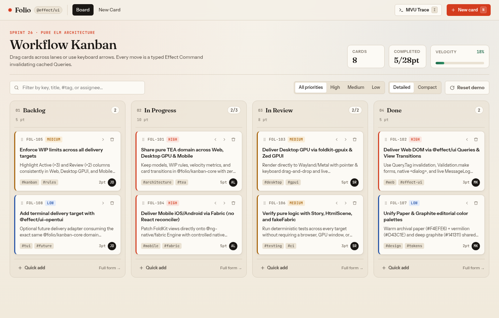

# Universal UI Framework (`@universal-ui/*`) + Folio Kanban (`@folio/kanban-*`)

**A reusable, app-agnostic cross-platform `@effect/ui` framework (`framework/`) built on Hexagonal Architecture (Ports & Adapters) with open Effect dependency injection — consumed by one unified Kanban application (`apps/kanban/`) running natively across Web DOM, Desktop Zed GPUI, and Mobile React Native Fabric. Zero React reconcilers. Zero WebViews.**

---

## Screenshots Across Every Platform

### 1. Web DOM (`@folio/kanban-app` → `@universal-ui/host-web` + Vite — No React)


### 2. Desktop Native GPU (`@folio/kanban-app` → `@universal-ui/host-gpui` → Zed GPUI on Wayland)


### 3. Mobile Native Android (`@folio/kanban-app` → `@universal-ui/host-fabric` → `@ng-native/fabric`)
<p align="center">
  
</p>

---

## Hexagonal Architecture

The repository strictly separates **ports**, **implementation concerns** (rendering, storage, platform lifecycle/viewport/IDs), and the **consumer application**, with one-way dependencies (`framework/` has zero knowledge of Folio or Kanban):

```text
╔═════════════════════════════════════════════════════════════════════════════╗
║                   FRAMEWORK (App-Agnostic · framework/)                     ║
║                                                                             ║
║   @universal-ui/core                   @universal-ui/behaviors              ║
║   • "universal-ui" View.Vocabulary     • @ui-sdk/core headless controls     ║
║     (box, scroll, button, text,          (segmentedControl, tabs, progress) ║
║      input, textarea + UiStyle)        • locale-aware text-match/highlight  ║
║   • Pure Outbound Ports:               • generic history & transfer notice  ║
║     - KeyValueStore · Lifecycle                                             ║
║     - Viewport · IdGenerator                                                ║
║                                                                             ║
║   Decoupled Non-Rendering Implementation Packages:                          ║
║   • @universal-ui/storage  (./browser localStorage, ./fs node:fs, ./memory) ║
║   • @universal-ui/platform (./browser resize/vis, ./node crypto, ./memory)  ║
║                                                                             ║
║   Pure Driven UI Rendering Hosts (Renderer.Host<Node> + Ui.Host):           ║
║   ┌─────────────────────┐ ┌──────────────────────┐ ┌─────────────────────┐  ║
║   │@universal-ui/       │ │@universal-ui/        │ │@universal-ui/       │  ║
║   │  host-web           │ │  host-gpui           │ │  host-fabric        │  ║
║   │Pure DOM Renderer    │ │Zed GPUI Renderer     │ │RN C++ Fabric Engine │  ║
║   │+ FakeDom testing    │ │+ FakeGpui testing    │ │+ AppState & testing │  ║
║   └─────────────────────┘ └──────────────────────┘ └─────────────────────┘  ║
╚══════════════════════════════════════▲══════════════════════════════════════╝
                                       │ consumes (strictly one-way)
╔══════════════════════════════════════┴══════════════════════════════════════╗
║                CONSUMER APP (Folio Kanban · apps/kanban/)                   ║
║                                                                             ║
║   @folio/kanban-domain (Inner Hexagon — pure TypeScript, zero UI/I/O)       ║
║   • Entities, WIP limits, velocity, pure immutable undo/redo, Schemas       ║
║   • Domain Outbound Port: BoardRepository (./ports — zero storage coupling) ║
║                                                                             ║
║   @folio/kanban-app (Application Core, Commands, Adapters & Driving UI)     ║
║   • Commands (./commands): kanbanCommandsLayer (SaveBoard · MintCardMeta)   ║
║     requires ONLY BoardRepository | IdGenerator (zero KeyValueStore coupling)║
║   • Storage Adapter (./adapters): keyValueBoardRepositoryLayer (optional)   ║
║   • Subscriptions: Lifecycle.changes · Viewport.changes (live responsive)   ║
║   • Driving UI: ONE FolioApp component + views & Paper/Graphite palettes    ║
║                                                                             ║
║   Platform Composition Roots (explicit Effect Layer dependency wiring):     ║
║   ┌─────────────────────┐ ┌──────────────────────┐ ┌─────────────────────┐  ║
║   │@folio/kanban-web    │ │@folio/kanban-desktop │ │@folio/kanban-mobile │  ║
║   │WebHost +            │ │GpuiHost +            │ │FabricHost +         │  ║
║   │storage/browser +    │ │storage/fs +          │ │storage/memory +     │  ║
║   │platform/browser     │ │platform/node         │ │fabricLifecycle +    │  ║
║   │                     │ │                      │ │platform/memory      │  ║
║   └─────────────────────┘ └──────────────────────┘ └─────────────────────┘  ║
╚═════════════════════════════════════════════════════════════════════════════╝
```

### Ports & Adapters Matrix

Every platform-specific application root explicitly wires every implementation `Layer` into the Effect graph — missing any dependency fails at **compile time** across Web, Desktop, and Mobile:

| Port | Layer | Web Root (`kanban-web`) | Desktop Root (`kanban-desktop`) | Mobile Root (`kanban-mobile`) | Test Double |
|---|---|---|---|---|---|
| **`Renderer.Host` + `Ui.Host`** | `@universal-ui/core` | `@universal-ui/host-web` (`WebHost`) | `@universal-ui/host-gpui` (`GpuiHost`) | `@universal-ui/host-fabric` (`FabricHost`) | `TestHost`, `FakeDom`, `FakeGpuixRenderer`, `FakeFabric` |
| **`KeyValueStore`** | `@universal-ui/core` | `@universal-ui/storage/browser` (`localStorage`) | `@universal-ui/storage/fs` (`node:fs` JSON) | `@universal-ui/storage/memory` | `makeMemoryKeyValueStore` |
| **`Lifecycle`** | `@universal-ui/core` | `@universal-ui/platform/browser` (`visibilitychange`) | `@universal-ui/platform/node` (`staticLifecycleLayer`) | `@universal-ui/host-fabric` (`fabricLifecycleLayer`) | `staticLifecycleLayer`, `fakeAppState` |
| **`Viewport`** | `@universal-ui/core` | `@universal-ui/platform/browser` (live `resize` stream) | `@universal-ui/platform/node` (`1280×800`) | `@universal-ui/platform/memory` (`390×844`, inset `56`) | `staticViewportLayer` |
| **`IdGenerator`** | `@universal-ui/core` | `@universal-ui/platform/browser` (`crypto.randomUUID`) | `@universal-ui/platform/node` (`node:crypto`) | `@universal-ui/platform/memory` (`cryptoIdGeneratorLayer`) | `makeSequenceIdGeneratorLayer` |
| **`BoardRepository`** | `@folio/kanban-domain/ports` | `keyValueBoardRepositoryLayer` → `storage/browser` | `keyValueBoardRepositoryLayer` → `storage/fs` | `keyValueBoardRepositoryLayer` → `storage/memory` | `makeMemoryBoardRepository` |

---

## Building Another App on `@universal-ui/*`

Any new application can live alongside `apps/kanban/` as a pure consumer without modifying `framework/`:

1. **Define your domain** in a pure TypeScript package (entities, rules, schemas) with zero UI or I/O imports.
2. **Define your app** using `Ui.component` from `@universal-ui/core` and headless behaviors from `@universal-ui/behaviors`, declaring open Effect dependencies on ports (`KeyValueStore`, `Lifecycle`, `Viewport`, `IdGenerator`, or domain ports).
3. **Wire platform composition roots** (`web`, `desktop-gpui`, `mobile-fabric`) that compose your app's open `Layer` with concrete adapters from `@universal-ui/storage/*`, `@universal-ui/platform/*`, and `@universal-ui/host-*`.

---

## Project Layout

```text
.
├── package.json                              # Explicit hexagonal npm workspaces
├── tsconfig.base.json                        # Shared strict + exactOptionalPropertyTypes config
├── framework/                                # Reusable @universal-ui/* Hexagonal Framework (zero app coupling)
│   ├── core/                                 # @universal-ui/core (Inner Hexagon: Ui vocabulary + pure outbound ports/)
│   ├── behaviors/                            # @universal-ui/behaviors (generic @ui-sdk/core headless controls)
│   └── adapters/                             # Outer-Ring Driven Adapters
│       ├── storage/                          # @universal-ui/storage (KeyValueStore: ./browser, ./fs, ./memory)
│       ├── platform/                         # @universal-ui/platform (Lifecycle, Viewport, IdGenerator: ./browser, ./node, ./memory)
│       └── renderers/                        # Pure UI Rendering Hosts (Renderer.Host<Node>)
│           ├── web-dom/                      # @universal-ui/host-web (DOM Renderer.Host + FakeDom testing)
│           ├── desktop-gpui/                 # @universal-ui/host-gpui (Zed GPUI Renderer.Host + FakeGpui testing)
│           └── mobile-fabric/                # @universal-ui/host-fabric (RN Fabric Renderer.Host + AppState + FakeFabric)
└── apps/
    └── kanban/                               # Folio Kanban — Hexagonal Consumer App (@folio/kanban-*)
        ├── domain/                           # Inner Hexagon (@folio/kanban-domain — zero UI/IO)
        │   └── src/
        │       ├── model/                    #   Entities, value objects, schemas, seed
        │       ├── rules/                    #   Pure domain operations & immutable session history
        │       └── ports/                    #   Domain outbound port (BoardRepository)
        ├── application/                      # Application Layer (@folio/kanban-app)
        │   └── src/
        │       ├── commands/                 #   Use-case Effect commands (SaveBoard, MintCardMeta)
        │       ├── adapters/                 #   Driven storage adapter (KeyValueBoardRepository)
        │       ├── presentation/             #   Kanban view-models, search, kanbanBoard primitive
        │       └── ui/                       #   Driving universal UI (FolioApp, theme, views/)
        └── targets/                          # Outermost Delivery Composition Roots (Effect Layer wiring)
            ├── web/                          # @folio/kanban-web (Web DOM + localStorage + Vite)
            ├── desktop-gpui/                 # @folio/kanban-desktop (Zed GPUI + FileStore + Node)
            └── mobile-fabric/                # @folio/kanban-mobile (RN Fabric + AppState + Expo)
```

---

## Quick Start

### 1. Install dependencies once at the root

```bash
npm install
```

### 2. Run type-checks, tests, and builds

```bash
npm run typecheck       # Strict + exactOptionalPropertyTypes across all 12 workspaces
npm test                # Runs framework tests (5 suites) + kanban consumer tests (5 suites)
npm run test:framework  # Runs framework tests only
npm run test:kanban     # Runs kanban app & delivery tests only
npm run build:web       # Production Vite build of @folio/kanban-web
```

### 3. Launch each delivery target

```bash
npm run dev:web         # Web DOM (@universal-ui/host-web + Vite)
npm run start:desktop   # Desktop Native GPU (@universal-ui/host-gpui -> Zed GPUI)
npm run start:mobile    # Mobile Native iOS/Android (@universal-ui/host-fabric -> Expo Dev Client)
```

For Android native builds (`cd apps/kanban/targets/mobile-fabric && npm run prebuild && npm run android`), Android SDK (API 36, NDK 27) and JDK 21 are required.

> **Note for Linux pure-Wayland desktops (e.g. Hyprland with `xwayland:enabled = false`)**: Android Emulator's bundled Qt ships `xcb` rather than Wayland. Run it inside a nested `labwc` Wayland window:
> ```bash
> WLR_WL_OUTPUTS=1 labwc -s "env QT_QPA_PLATFORM=xcb $ANDROID_HOME/emulator/emulator -avd <your_avd> -gpu auto"
> ```

---

## Credits & Upstream Projects

- **[@effect/ui](https://ui.effect.website)** & **[Effect](https://effect.website)** — Effect-TS team
- **[UI SDK (`@ui-sdk/core`)](https://ui-sdk.dev)** — Vercel Labs framework-agnostic interaction behaviors
- **[gpuix](https://github.com/remorses/gpuix)** & **[GPUI](https://github.com/zed-industries/zed/tree/main/crates/gpui)** — Zed GPU UI framework & Node/Bun bindings
- **[@ng-native/fabric](https://github.com/ng-native/ng-native)** — Direct React Native Fabric engine without React
- Inspired by **[Manzanita-Research/foldkit-native](https://github.com/Manzanita-Research/foldkit-native)** and **[giovannilondero/foldkit-native](https://github.com/giovannilondero/foldkit-native)**
